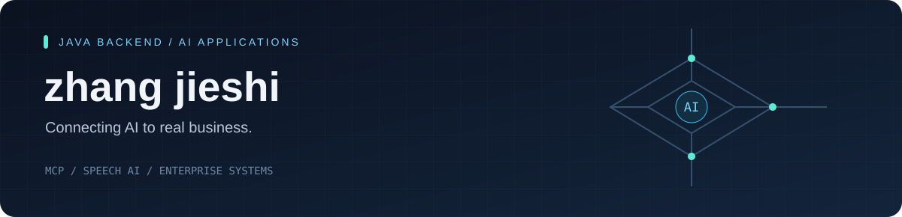

[English](https://github.com/kaiishityou126/kaiishityou126/blob/main/README.md) · **简体中文**

### Java Backend Engineer · AI Application Developer

用 Java 构建业务系统，让 AI 走进真实场景。

[AI 项目](#ai-projects) · [业务项目](#enterprise-experience) · [技术栈](#tech-stack)

## 👋 关于我

我是 **zhang jieshi**，专注 **Java 后端、AI 应用与企业系统集成**。

从制造业平台到电商订单系统，我关注软件在真实业务中的应用。目前重点实践 **Agent / MCP / RAG**，将模型能力与企业数据、现场作业流程连接起来。

## 🤖 精选 AI 项目

### 工厂智能镜子 Agent 平台
企业项目 · 项目技术负责人

**让员工在一个交互入口中查看任务、获取作业指导并查询业务信息。**

- **身份到任务**：人脸 / NFC 识别 → 员工主数据 → 作业资格校验 → 今日任务与 ESOP 作业指导书。
- **业务问答**：通过 MCP 查询 MES 任务、WMS / SAP 订单出货与库存，通过 RAG 检索作业指导书。
- **受控访问**：负责方案设计与核心开发，以 SQL 模板、白名单、只读账号及审计约束数据访问。

`Spring Boot` `Spring AI MCP` `pgvector` `Redis` `Vue`

---

### [Enterprise Connector MCP](https://github.com/kaiishityou126/enterprise-connector-mcp)
个人开源 · PoC

**为 AI Agent 提供隔离、可控的企业数据访问能力。**

- 将数据库与 HTTP API 暴露为 MCP 工具，按租户隔离数据源、权限、工具定义与缓存。
- 结合受控 SQL 查询、两级缓存、配置热更新与调用审计，探索企业 AI 接入的工程实现。

[后端源码 ↗](https://github.com/kaiishityou126/enterprise-connector-mcp) · [管理控制台 ↗](https://github.com/kaiishityou126/enterprise-connector-admin-ui)  
管理控制台持续建设中。

---

### [海星同传 · SeaStar Voice Translator](https://github.com/kaiishityou126/voice_translator)
个人开源 · 桌面应用

**把会议、视频与直播中的声音变成实时双语字幕。**

- 本地语音识别，支持系统音频 / 麦克风输入、字幕悬浮窗及多种翻译引擎，可搭配本地 Ollama。
- 支持双向语音回灌、说话人声纹门控，以及会话摘要与历史回看。

[源码与使用说明 ↗](https://github.com/kaiishityou126/voice_translator)  
主要面向 Windows；macOS 待真机验证。

## 🏭 企业项目经历

**工厂制造业综合业务平台 · 企业项目**  
覆盖 WMS / MES / QMS / MDM，参与核心流程设计，对接 **SAP / ASPROVA**；负责整体技术方案，并参与上线交付与问题闭环。

**电商订单接入与处理系统 · 企业项目 · 技术负责人**  
连接外部平台与内部订单系统，参与 **RabbitMQ 异步消息、延迟交换机与 DLQ** 开发；实现 core / order 双库写入，按新旧系统要求采用差异化异常处理。

## 🛠️ 技术栈

**后端与数据**

| 方向 | 技术与实践 |
| :--- | :--- |
| 后端服务 | Java 17 / 21、Spring Boot、Spring Cloud、REST API、WebClient |
| 数据持久化 | PostgreSQL、Oracle、MariaDB、Spring Data JPA、MyBatis-Flex；新旧系统双库写入 |
| 缓存与消息 | Redis + Caffeine 两级缓存、缓存失效、RabbitMQ 异步处理、延迟交换机、死信队列 |
| 企业系统集成 | SAP / ASPROVA 接口对接、MES / WMS 业务流程、多租户数据源路由 |
| 访问控制与可观测性 | 租户隔离、SQL 模板与白名单校验、限流、审计日志、Micrometer / Prometheus |
| 工程与交付 | Maven / Gradle、Checkstyle、单元与集成测试、上线部署及问题排查 |

**AI 与应用开发**

`Spring AI` · `Agent / MCP / RAG` · `pgvector` · `Ollama` · `sherpa-onnx`

---

欢迎交流 AI 应用、Java 后端与企业系统集成。  
[浏览我的项目 →](https://github.com/kaiishityou126?tab=repositories)

